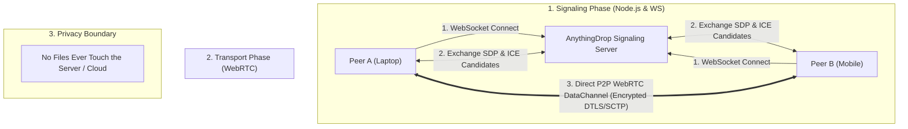
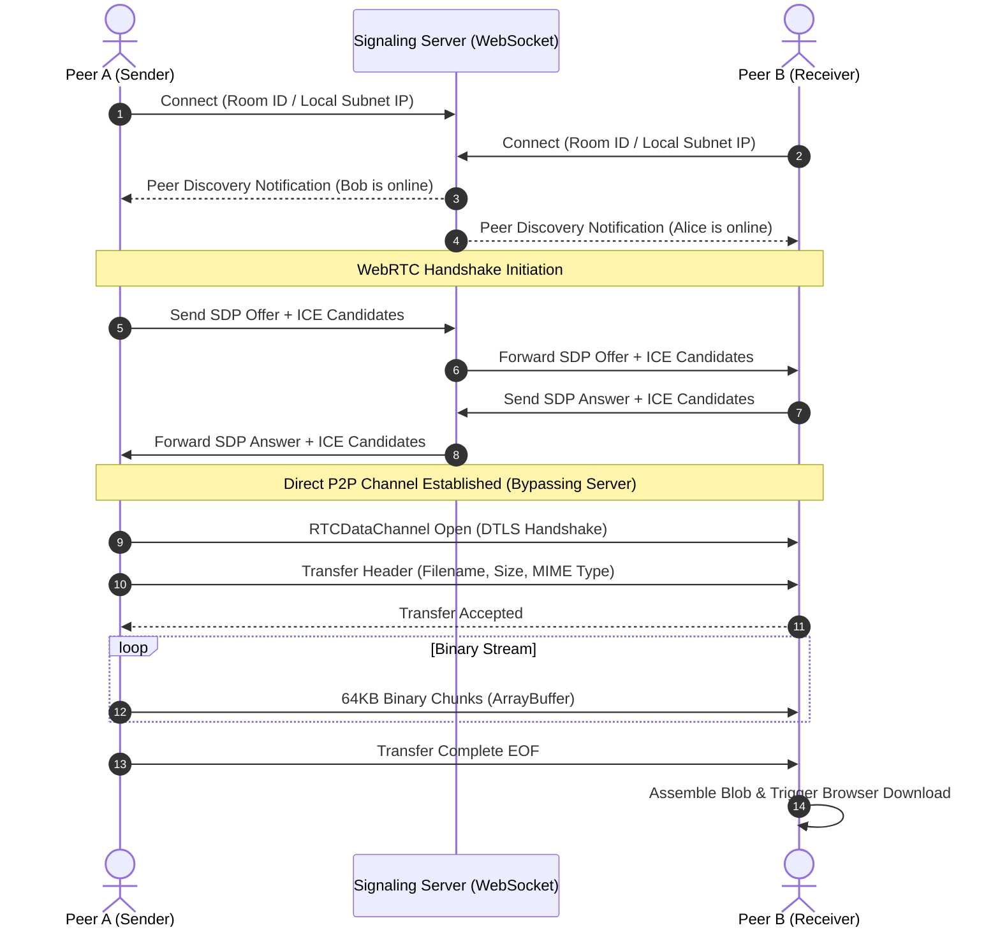

# AnythingDrop: Decentralized Cross-Platform Peer-to-Peer File Transfer System
**Comprehensive Technical Report & Project Documentation**

---

## 1. Abstract

In today's multi-device computing environment, cross-platform file sharing remains constrained by proprietary ecosystems (e.g., Apple AirDrop) or privacy-invasive, bandwidth-intensive cloud storage services (e.g., Google Drive, WhatsApp). **AnythingDrop** is an open-source, client-side, peer-to-peer (P2P) progressive web application that enables zero-setup, zero-signup, high-speed file transfer across arbitrary operating systems (iOS, Android, Windows, macOS, Linux). Utilizing **WebRTC DataChannels** layered over **SCTP/DTLS/UDP**, AnythingDrop streams files directly between devices within local networks at hardware wire speeds without routing file payloads through intermediate cloud storage. This document provides the complete architectural design, network protocol flow, security guarantees, deployment specifications, and technical viva defense material for academic and enterprise evaluation.

---

## 2. Problem Statement & Motivation

### 2.1 Shortcomings of Existing Solutions

| Solution | Ecosystem Barrier | Bandwidth Overhead | Cloud Storage / Privacy Risk | File Size Caps |
| :--- | :--- | :--- | :--- | :--- |
| **Apple AirDrop** | Apple-only (iOS / macOS) | Zero (Local Wi-Fi / Bluetooth) | None | None |
| **Quick Share (Google)** | Android / Windows focus | Zero (Local P2P) | None | Dependent on OS |
| **Cloud Storage** | Universal (Web) | **200%** (Upload + Download) | **High** (Third-party servers) | 15 GB free cap |
| **Messaging (WhatsApp)** | Universal | 200% (Upload + Download) | Medium (Meta Servers, Compression) | 2 GB cap + re-compression |

### 2.2 The AnythingDrop Solution
AnythingDrop eliminates both the hardware walled garden and the cloud intermediary:
1. **Universal Browser Access:** Requires zero software installation; functions via any standards-compliant browser.
2. **True P2P Streaming:** Files are read as native binary `ArrayBuffer` chunks and streamed directly between device network interfaces.
3. **Zero-Knowledge Privacy:** Cryptographic end-to-end encryption ensures neither the signaling server nor internet service providers can inspect or reconstruct payloads.

---

## 3. System Architecture & Component Design

AnythingDrop consists of three decoupled layers:
1. **The Signaling Layer (Node.js & WebSockets):** Acts as the rendezvous point for network discovery and Session Description Protocol (SDP) exchanges.
2. **The Transport Layer (WebRTC DataChannel):** Directly connects two peers using ICE (Interactive Connectivity Establishment) candidates and STUN.
3. **The Presentation & Client Layer (HTML5, PWA, Web Workers):** Manages file chunking, UI state, device pairings, and background ServiceWorkers.



---

## 4. Network Protocol & Handshake Flow

The life cycle of an AnythingDrop file transfer follows an asynchronous multi-stage handshake:



---

## 5. Security & Cryptographic Analysis

1. **Transport Layer Security:** All signaling occurs over secure WebSockets (`wss://`) and HTTPS.
2. **DTLS-SRTP Encryption:** WebRTC mandates Datagram Transport Layer Security (DTLS). All data sent across the `RTCDataChannel` is encrypted end-to-end with AES-GCM cipher suites.
3. **Zero Payload Logging:** The signaling server only handles connection metadata (`peer_id`, `sdp`, `candidate`). Binary payloads never pass through server memory unless WebSocket fallback is explicitly invoked under hostile symmetric NATs.
4. **Session Ephemerality:** Peer IDs and temporary public rooms are generated pseudo-randomly using cryptographically secure random number generators (CSPRNG).

---

## 6. Project Structure

```text
anything-drop/
├── api/
│   └── config.js              # Vercel Serverless Function for configuration routing
├── dev/                       # Local SSL and development certificates
├── docs/                      # Technical manuals and architectural specifications
├── public/                    # Frontend Client Progressive Web Application (PWA)
│   ├── fonts/                 # OpenSans localized webfonts
│   ├── images/                # PWA icons, avatars, and assets
│   ├── lang/                  # Internationalization (i18n) dictionaries
│   ├── scripts/               # Client-side core logic
│   │   ├── network.js         # WebRTC and WebSocket connection manager
│   │   ├── ui-main.js         # Peer discovery rendering and DOM controller
│   │   ├── persistent-storage.js # Device pairing & local settings storage
│   │   └── service-worker.js  # PWA offline cache and installation handler
│   ├── styles/                # Responsive glassmorphism stylesheets
│   ├── index.html             # Application entrypoint
│   └── manifest.json          # PWA metadata & Web App Manifest
├── server/                    # Node.js backend & signaling engine
│   ├── helper.js              # IP normalization and subnet utilities
│   ├── index.js               # Server bootstrapper & port binder
│   ├── peer.js                # Peer state representation
│   ├── server.js              # Express HTTP static & config server
│   └── ws-server.js           # RFC 6455 WebSocket signaling server
├── Dockerfile                 # Multi-stage lightweight Alpine container
├── Procfile                   # Process descriptor for PaaS
├── railway.json               # Railway cloud infrastructure definition
├── render.yaml                # Render 1-click cloud orchestration
├── vercel.json                # Vercel serverless deployment specification
└── package.json               # Dependencies & lifecycle scripts
```

---

## 7. Deployment Guide

### 7.1 Deploying to Vercel (Frontend & Web Client)
1. Import `https://github.com/manirajsrikoti-alt/anything-drop` into your [Vercel Dashboard](https://vercel.com/new).
2. Vercel automatically detects `vercel.json` and `api/config.js`.
3. Click **Deploy**. Vercel will deploy the edge frontend with global CDN caching and automatic HTTPS.

### 7.2 Deploying Full-Stack Signaling Instance (Render / Railway)
Because WebRTC signaling requires persistent bidirectional WebSockets, AnythingDrop can also be deployed with 1 click to persistent container runtimes:
* **Render:** Create a Web Service pointing to `render.yaml` (Free Tier).
* **Railway:** Select `Deploy from GitHub repo` ➔ `anything-drop`.

### 7.3 Local Execution (Development & Demo)
```bash
git clone https://github.com/manirajsrikoti-alt/anything-drop.git
cd anything-drop
npm install
npm start
```
* Access on Laptop: `http://localhost:3000`
* Access on Smartphone: Connect to the same Wi-Fi and open `http://<YOUR_LAN_IP>:3000`

---

## 8. College Viva Voce Defense (Top Q&A)

### Q1: Why use WebRTC instead of HTTP or WebSockets for file transfer?
> **Answer:** Standard HTTP/WebSocket transfers follow a client-server paradigm where the file must travel from Peer A to the server, and then from the server to Peer B. This doubles bandwidth consumption, introduces server storage bottlenecks, and limits file sizes. WebRTC creates a direct P2P connection between device network cards, achieving LAN wire speeds without server overhead.

### Q2: What is the role of the Signaling Server if WebRTC is peer-to-peer?
> **Answer:** Browsers on different devices do not know each other's IP addresses or port numbers due to NAT (Network Address Translation) and firewalls. The signaling server acts as an initial matchmaker: it exchanges Session Description Protocol (SDP) objects and ICE candidates between peers. Once the handshake succeeds, the signaling server drops out of the communication loop.

### Q3: What is the difference between STUN and TURN?
> **Answer:** STUN (Session Traversal Utilities for NAT) allows a client behind a NAT router to discover its public IP address and port mapping. If both peers are behind moderate NATs, STUN is sufficient for direct P2P. If one peer is behind a strict symmetric NAT (common in corporate or college firewalls), direct UDP packets are blocked; in that case, TURN (Traversal Using Relays around NAT) or our WebSocket relay acts as an encrypted packet forwarder.

### Q4: How is security preserved if a public signaling server is used?
> **Answer:** WebRTC mandates end-to-end encryption using DTLS (Datagram Transport Layer Security) and SRTP. Even if the signaling server is compromised, the attacker only sees cryptographic SDP parameters and network routing candidates—the actual encryption keys are negotiated directly between peers via ephemeral Diffie-Hellman key exchange.

---

## 9. Conclusion & Future Roadmap

**AnythingDrop** successfully demonstrates a modern, decentralized approach to everyday digital utility. By combining the accessibility of Progressive Web Apps with the high throughput of WebSockets and WebRTC, it eliminates proprietary ecosystem silos while guaranteeing total user privacy.

*Future enhancements include multi-peer mesh multicasting for broadcasting files to an entire classroom simultaneously, folder directory streaming via the File System Access API, and end-to-end encrypted ephemeral text channels.*
